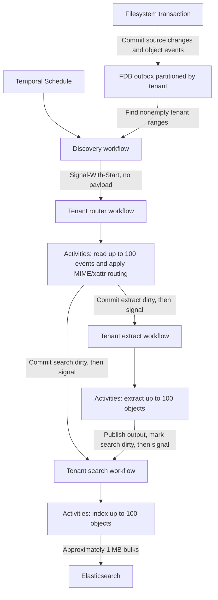

# dfs:// transactional outbound proposal

Filesystem mutations and outbox events commit together in FDB. A Temporal Schedule discovers tenants
with pending events and wakes their router workflows. Each tenant router routes objects to
extraction or search. Temporal outages pause background work while filesystem writes accumulate events.



The tenant router deletes selected events after stage signals are accepted. Activities clear
matching dirty keys only after successful processing.

## Keys

```text
dfs-v1-{env}/outbox/events/<tenant_id>/<event_id>
dfs-v1-{env}/extract/<tenant_id>/dirty/<object_id>
dfs-v1-{env}/search/<tenant_id>/dirty/<object_id>
```

An event's value is only `object_id`. Its ID is an FDB commit versionstamp plus an ordinal, encoded
with `Versionstamp::incomplete(ordinal)` and `SetVersionstampedKey`. Enqueue assigns distinct `u16`
ordinals within the transaction; FDB fills the commit stamp atomically. Events sort by tenant, then
commit stamp and ordinal.

Dirty values retain a commit-time work stamp, the source version being processed, and pending-since
time. They track unfinished work after events are acknowledged. There are no router marker keys.

## Writing transaction

Proposed API:

```rust
let (mutations, commit_version) = fdb::with_idempotent_transaction(|tx| {
    let operations = &operations;
    let session = &session;
    let tenant_id = &authenticated_tenant_id;
    async move {
        let mutations = ObjectResource::apply(&tx, session, operations.clone()).await?;
        OutboxEvent::enqueue(&tx, tenant_id, operations, &mutations).await?;
        Ok(mutations)
    }
})
.await?;
```

Enqueue records successful relevant mutations, deduplicates object IDs within the attempt, and uses
operation inputs to retain removed object IDs. It performs no routing metadata reads. Source changes
and events roll back together; FDB errors and transaction receipts retain their existing retry behavior.

## Discovery and tenant routing

1. A recurring Temporal Schedule starts a discovery workflow with `BufferOne` overlap policy. Its
   activities find nonempty tenant event ranges: read one key, then seek past that tenant's prefix.
   Bound each scan and carry its cursor forward so large tenants cannot block discovery.
2. Discovery sends payload-free Signal-With-Start to `dfs-router/<tenant_id>`. The tenant is a start
   argument. Repeated ticks wake the same workflow rather than creating concurrent routers.
3. Tenant router activities read up to 100 events, coalesce object IDs, and load current MIME type
   and the object's own `dfs.search.exclude` xattr. Commit the appropriate dirty keys:

   | Current object | Work |
   | --- | --- |
   | Eligible `text/*` file | Search dirty. |
   | Eligible non-text file | Extract dirty; processing later hands off to search. |
   | Missing or excluded object | Search dirty for index cleanup. |
   | Directory | Search reconciliation. |

4. After the dirty writes commit, send at most one payload-free Signal-With-Start per affected stage:
   `process` to `dfs-extract/<tenant_id>`, `search` to `dfs-search/<tenant_id>`.
5. Delete only the selected events after all required signals are accepted. Continue in bounded
   batches. Failed or uncertain delivery retains events; retries may repeat routing and signals.

FDB reads/writes and Temporal client calls run in activities. No FDB transaction spans a Temporal RPC.
Events request reconciliation of current state, not replay of historical mutations. Exclusion applies
only to the object carrying the xattr. Detailed indexing rules live in [SEARCH.md](SEARCH.md).

## Processing and completion

Each tenant has three stable workflows: router, extract, and search. Parallelism comes from bounded
activities on shared workers, not workflows per object. Activities handle up to 100 dirty objects;
search publishes approximately 1 MB encoded bulks. Bound per-tenant concurrency and workflow history.

Extraction completion atomically publishes output, clears the matching extract dirty key, and marks
search dirty. The activity then signals the search workflow and completes only after acceptance.
Retries reuse committed output and still deliver the signal, even if the extract key is already gone.

Search clears a dirty key only after successful publication and a conflict-tracked comparison of its
work stamp. Newer work and failed bulk items remain dirty. Validate source versions and reject stale
index writes. Repeated routing preserves pending age and must not erase newer obligations.

For example, one request writes a text file and a PDF. Two events wake one tenant router, which
marks search/extract dirty and signals both stage workflows. The text can be indexed while the PDF
is extracted; extraction then marks the PDF search-dirty and wakes search again.

## Recovery

Accepted signals are durable delivery, not business completion. Dirty keys survive terminated
workflows. Scheduled discovery periodically scans dirty ranges as well and re-signals the matching
stage workflows, including tenants whose event queues are empty. Preserve dirty stamps and ages.

Alert on backlog age, stalled discovery, failed activities, and partial search-bulk failures. After
Temporal recovery, resume scans of retained FDB work; replaying every missed schedule tick is unnecessary.
