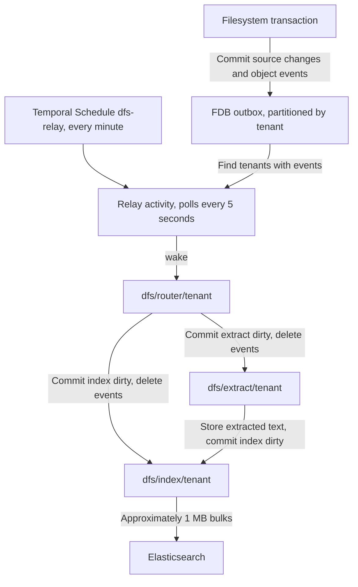

# dfs:// transactional outbound proposal

Filesystem mutations and outbox events commit together in FDB. The **relay** polls FDB for tenants
with pending work and wakes their **stage** workflows: **router**, **extract**, and **index**. The
router classifies changed objects into extract or index dirty ranges. Extract turns binary files into
text. Index publishes to Elasticsearch. Temporal outages pause background work while filesystem
writes keep accumulating events.



Dirty keys are the durable record of unfinished work. Signals only wake workflows. Losing one delays
work until the next relay poll and never loses it.

## Vocabulary

| Name | Role |
| --- | --- |
| Outbox | Object-ID events written in the filesystem transaction. |
| Relay | Polls FDB for tenants with outbox events or dirty work and wakes their stage workflows. |
| Stage | One step of the indexing pipeline: `router`, `extract`, or `index`. One workflow per stage and tenant. |
| Router | Classifies changed objects by current MIME type and exclusion into stage dirty ranges. |
| Extractor | Per-MIME implementation turning a binary file into text, such as Tika for PDF and Office files. |
| Dirty | Per-object pending work for one stage, cleared only when that work completes. |
| Failed | Per-object terminal failure for one stage, retained for repair and never retried automatically. |
| `wake` | Payload-free signal asking a stage workflow to read FDB again. |

## Keys

```text
dfs-v1-{env}/outbox/events/<tenant_id>/<event_id>
dfs-v1-{env}/extract/<tenant_id>/dirty/<object_id>
dfs-v1-{env}/extract/<tenant_id>/failed/<object_id>
dfs-v1-{env}/index/<tenant_id>/dirty/<object_id>
dfs-v1-{env}/index/<tenant_id>/failed/<object_id>
```

Ranges are stage-first and tenant-second so the relay finds tenants with work by reading one key and
seeking past that tenant's prefix. No marker key records which tenants have work.

An event's value is only `object_id`. Its ID is an FDB commit versionstamp plus an ordinal, encoded
with `Versionstamp::incomplete(ordinal)` and `SetVersionstampedKey`. Enqueue assigns distinct `u16`
ordinals within the transaction; FDB fills the commit stamp atomically. Events sort by tenant, then
commit stamp and ordinal.

Dirty values hold a commit-time work stamp, the source version to process, `changed_at` (latest
source change, used for the 10-second debounce), and `pending_since` (first unprocessed change, used
for lag). Failed values hold the work stamp, a bounded error category, and the failure time.

## Writing transaction

Proposed API:

```rust
let (mutations, commit_version) = fdb::with_idempotent_transaction(|tx| {
    let operations = &operations;
    let session = &session;
    let tenant_id = &authenticated_tenant_id;
    async move {
        let mutations = ObjectResource::apply(&tx, session, operations.clone()).await?;
        OutboxEvent::enqueue(&tx, tenant_id, operations, &mutations).await?;
        Ok(mutations)
    }
})
.await?;
```

Enqueue records successful relevant mutations, deduplicates object IDs within the attempt, and uses
operation inputs to retain removed object IDs. It performs no routing metadata reads. Source changes
and events roll back together; FDB errors and transaction receipts retain their existing retry behavior.

## Relay

1. A Temporal Schedule `dfs-relay` starts the relay workflow every minute with the `Skip` overlap
   policy. The workflow runs one heartbeating relay activity for up to 55 seconds.
2. The activity polls every 5 seconds. It scans the outbox, extract dirty, and index dirty ranges for
   tenants with work, in bounded pages with a cursor so large tenants cannot block the scan.
3. For each tenant found, it sends `wake` through Signal-With-Start to the matching stage workflow:
   events to `dfs/router/<tenant_id>`, extract dirty to `dfs/extract/<tenant_id>`, index dirty to
   `dfs/index/<tenant_id>`. Each stage and tenant is woken at most once per activity run.
4. The relay never writes FDB and never reads failed ranges.

Sub-minute polling runs inside one heartbeating activity, following Temporal's guidance for frequent
polling. The Schedule only restarts the loop. The relay is also the recovery path: dirty work left by
a terminated workflow or a lost signal is found on the next poll.

## Stage workflows

Router, extract, and index run the same workflow, parameterized by stage:

| Stage | Input range | Task queue | Batch | Parallel batches per tenant | Output |
| --- | --- | --- | --- | --- | --- |
| `router` | Outbox events | `dfs-router` | 1,000 events | 1 | Extract or index dirty keys. |
| `extract` | Extract dirty | `dfs-extract` | 10 objects | 4 | Extracted text and index dirty keys. |
| `index` | Index dirty | `dfs-index` | 100 objects, about 1 MB | 8 | Elasticsearch documents and tombstones. |

Each loop iteration:

1. `claim` reads due keys after the workflow's cursor and returns batches of object IDs plus the next
   due time. A dirty key is due once its `changed_at` is at least 10 seconds old. Events are due
   immediately.
2. The workflow starts one `process` activity per batch, keeping at most the stage's in-flight limit
   running, and claims again as slots free up. The cursor makes batches disjoint, so no object is
   processed by two activities at once. At the end of the range, the cursor wraps around once no
   batch is in flight.
3. With nothing due, the workflow sleeps until the next due time or a `wake`. With nothing left, it
   exits. The relay or another stage starts it again when new work appears.
4. The workflow continues as new when Temporal suggests it. History holds only object IDs, cursors,
   and counts.

The in-flight limit bounds each tenant's share of the shared task queues, so one tenant's backfill
cannot starve others. Large tenants get a higher limit through per-tenant configuration, not more
workflows.

## Routing

Router `process` coalesces object IDs from its events, loads each object's current MIME type and its
own `dfs.search.exclude` xattr, then commits in one transaction the dirty keys below and the deletion
of the events it read. After commit it wakes the affected stage workflows. A failed wake is left to
the relay.

| Current object | Work |
| --- | --- |
| `text/*` file | Index dirty. |
| Binary file with an extractor | Extract dirty. |
| Binary file without an extractor | Index dirty, name and metadata only. |
| Missing or excluded object | Index dirty, to tombstone its document. |
| Directory | Index dirty. |

Exclusion applies only to the object carrying the xattr, and an excluded object always routes to
index so its document is tombstoned. A file with an extractor reaches the index once extraction
succeeds. Events request reconciliation of current state, not replay of
historical mutations.

## Completion and failures

Extract `process` stores extracted text, then in one transaction switches the current generation,
clears the extract dirty key if its work stamp still matches, and sets index dirty. It then wakes the
index workflow. A failed wake is left to the relay. Retries reuse committed output.

Index `process` publishes one bulk and clears each successful object's dirty key only if its work
stamp still matches. Newer work stays dirty. Transient failures, including failed bulk items, leave
the key dirty for the activity's retries.

A terminal failure moves the object from its stage's dirty range to its failed range in one
transaction, only if the work stamp still matches. A later source change creates new dirty work as
usual. Failed entries are retried only through explicit repair.

FDB reads, FDB writes, and Temporal client calls run in activities. No FDB transaction spans a
Temporal RPC.

## Deployments

One `dfs-indexer` binary runs in three deployments:

| Deployment | Task queues | Bottleneck |
| --- | --- | --- |
| `core` | `dfs-relay`, `dfs-router` | FDB and Temporal. |
| `index` | `dfs-index` | Elasticsearch. |
| `extract` | `dfs-extract` | Extractors, such as a dedicated Tika. |

Each deployment scales on its task queue backlog. Extract concurrency is sized to extractor capacity.

## Observability

- Freshness: `process` activities report lag (`now - pending_since`) per stage. Alert above 30 minutes.
- Backlog: each relay poll reports, per stage, the number of tenants with work and estimated range
  sizes per tenant.
- Failures: failed range sizes per stage, activity failures, bulk item failures, and missing relay
  heartbeats.
- Temporal: workflow IDs are `dfs/<stage>/<tenant_id>`, with `DfsStage` and `DfsTenant` search
  attributes.

After a Temporal outage, the relay resumes from FDB state. Missed schedule ticks need no replay.
